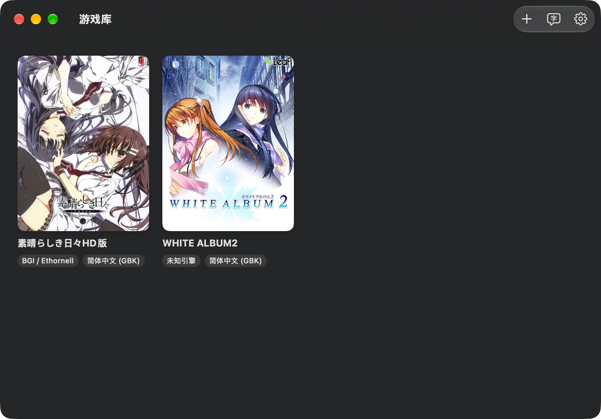
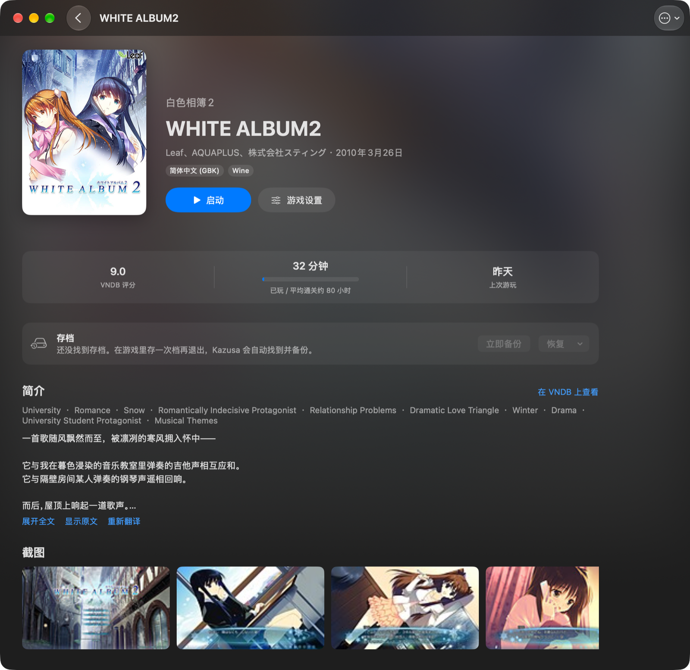

<div align="center">


# Kazusa

**在 Mac 上玩 Windows galgame 的原生启动器**

汉化版开箱即玩 · 日文原版配 LLM 实时翻译

[](https://github.com/Shizuku11451/kazusa/actions/workflows/ci.yml)
[](https://github.com/Shizuku11451/kazusa/releases/latest)
[](LICENSE)


[快速开始](#快速开始) · [功能](#功能) · [从源码构建](#从源码构建) · [路线图](#路线图) · [参与贡献](CONTRIBUTING.md)

</div>





## 亮点

- 🎮 **拖进来就能玩**：自动识别 15 种引擎、主程序和语言版本，转区、字体替换、Wine 前缀都不用手动配置。
- 🪄 **能不经过 Wine 就不经过**：NScripter 走 ONScripter，KiriKiri 走 krkr2，不需要 Wine 和 Rosetta；跑不了的自动退回 Wine。
- 🈂️ **日文原版实时翻译**：LunaHook 直接读出台词，不用截图、不用对准文本框；读不到的游戏用 OCR。译文用你自己配置的 LLM 生成，显示在字幕条里。
- 🖼️ **像样的游戏库**：从 VNDB 自动拉封面、简介、标签、截图和角色；记录游玩时长；存档自动备份，随时恢复。
- 🧩 **纯原生**：SwiftUI + Swift Package。没有用 CrossOver / Whisky 等现有前端，唯一的外部依赖是 Wine 本身。

## 快速开始

**安装 Kazusa**（二选一）：

- **dmg 安装包（推荐）**：从 [Releases](https://github.com/Shizuku11451/kazusa/releases/latest) 下载 `Kazusa-*-macOS.dmg`，打开后把 Kazusa 拖进「应用程序」。这是通用二进制，Apple 芯片和 Intel 都能用。

  这个版本**没有经过 Apple 公证**，第一次打开会被拦下。macOS 15 及以后：被拦下后到「系统设置 → 隐私与安全性」，点「仍要打开」；macOS 14：右键 → 打开。也可以在终端运行：
  ```sh
  xattr -dr com.apple.quarantine /Applications/Kazusa.app
  ```
- **从源码构建**：需要 Swift 6（装 Command Line Tools 就够）。自己构建的程序不会被 Gatekeeper 拦下。
  ```sh
  git clone https://github.com/Shizuku11451/kazusa.git && cd kazusa
  scripts/build-app.sh && cp -R build/Kazusa.app /Applications/
  ```

**然后**：

把游戏文件夹或 exe 拖进窗口，点「启动」。缺 Rosetta 2 或 Wine 时会弹窗问你，点一下就装，装好后自动接着启动：

- **Rosetta 2**（仅 Apple 芯片）：要输一次登录密码。
- **Wine**：下载 Kazusa 测试过的 [Gcenx](https://github.com/Gcenx/macOS_Wine_builds) `wine-staging-11.21-osx64`（约 217 MB），校验后安装。想用别的版本，在「设置 → 运行环境」里导入压缩包或填路径。

> [!NOTE]
> NScripter 游戏和未加密的 KiriKiri 游戏（仅 Apple 芯片）默认原生运行，不需要 Rosetta 和 Wine。

> [!TIP]
> 只有用 OCR 翻译时才需要**屏幕录制权限**（系统设置 → 隐私与安全性 → 屏幕与系统录音），文本钩子不需要。

> [!WARNING]
> Homebrew 的 `wine-stable` / `wine@staging` cask 因为过不了 Gatekeeper 检查，已在 2026-09-01 被禁用，请用上面的压缩包。
>
> 较新的 macOS（已确认 27.x）上，Rosetta 处理 WoW64 模式切换有 bug，32 位游戏会随机崩溃或卡死。Kazusa 启动游戏时会自动给托管的运行时和前缀换上修复版 `wow64cpu.dll`（已预编译 Wine 11.0、11.20、11.21），详见 [ThirdParty/wow64cpu-rosetta](ThirdParty/wow64cpu-rosetta/README.md)。

## 功能

### 游戏库

| | |
|---|---|
| **导入** | 拖入文件夹或 exe。自动识别引擎（KiriKiri、NScripter、Ren'Py、Unity 等 15 种）和主程序，并按文件名判断是汉化版还是日文原版 |
| **封面** | 先找游戏目录里的 cover / package 等图片，没有再按标题查 [VNDB](https://vndb.org)（查之前会去掉“HD版”“汉化版”、版本号这类修饰），只自动采用非成人封面。也可以手动搜索，或者把图片拖到详情页 |
| **资料** | 从 VNDB 拉取中文名、原名、品牌、发售日、平均通关时长、评分、简介（去掉剧透段落）、标签、截图和主要角色。英文简介可以一键用 LLM 翻成中文 |
| **游玩记录** | 记录游玩时长，对照 VNDB 的平均通关时长显示进度 |
| **存档** | 游戏退出后自动找到改动过的存档并备份，可以从任意一份备份恢复（恢复前会先把当前存档备份一份） |

### 运行

| | |
|---|---|
| **原生运行** | NScripter 用打包的 [ONScripter](ThirdParty/onscripter-yuri/)（OnscripterYuri），自动判断脚本编码（Shift-JIS / GBK / UTF-8）；未加密的 KiriKiri 用 krkr2（仅 Apple 芯片）。都可以在游戏设置里改回 Wine |
| **转区** | 每个游戏可选简中 / 繁中 / 日文区域（`zh_CN` / `zh_TW` / `ja_JP`）。同一区域共用一个 Wine 前缀，也可以给单个游戏开独立前缀（APFS 克隆，不占额外空间） |
| **字体** | 按区域把 MS Gothic、SimSun 等替换成 macOS 自带字体，并配置字体链接，菜单和对话框也不会出方块字 |
| **运行时** | 自动发现 /Applications 和 Homebrew 里的 Wine，也可以从 `.tar.xz` 导入 |
| **视频** | Gcenx wine-staging 自带的 GStreamer 能解 MPEG-1/2、WMV、H.264 等格式；运行时缺解码组件时，设置页和日志里会有提示 |

### 翻译

| | |
|---|---|
| **文本钩子** | 用 Wine 启动日文游戏时，自动注入 [LunaHook](ThirdParty/lunahook/)（按游戏位数选 32 / 64 位），直接读出台词。游戏有好几路文本时自动挑对白那一路，也可以手动指定或输入特殊码。ONScripter 原生运行时，由引擎直接把台词交给 Kazusa |
| **OCR 悬浮窗** | 钩不到时改用 OCR：半透明取景框盖在文本框上，ScreenCaptureKit 截图、Vision 识别。支持手动、自动（画面稳定后才翻译）、剪贴板三种模式；全局快捷键 ⇧⌘R 识别、⇧⌘L 锁定（点击穿透） |
| **LLM** | 支持 OpenAI 兼容接口（DeepSeek、Ollama、LM Studio、各类中转）和 Anthropic 接口。翻译时带上前文和每个游戏的术语表，流式输出；翻过的句子会存下来，再次遇到不再调用 LLM |

> [!IMPORTANT]
> **隐私**：联网查资料时，只会把游戏标题和 VNDB 条目编号发给 api.vndb.org。翻译时，文本只会发给**你自己配置**的 LLM 服务。API Key 单独存放在只有你能读的文件里。

## 从源码构建

需要 macOS 14+ 和 Swift 6。只装 Command Line Tools 就够，不需要 Xcode。

```bash
swift run Kazusa            # 开发时直接运行
scripts/build-app.sh        # 打包到 build/Kazusa.app
scripts/make-dmg.sh         # 再做成 dmg 安装包：build/Kazusa-<版本>-macOS.dmg
scripts/test.sh             # 跑单元测试
swift run kazusa-cli        # 命令行工具：安装运行时、识别游戏、不开界面直接启动
```

签名、独立数据目录、代码结构等开发说明见 [CONTRIBUTING.md](CONTRIBUTING.md)。

## 路线图

- [x] **原生后端**：能用就不经过 Wine，用不了自动回退 Wine（Wine 仍是主路线，不追求原生覆盖率）
  - [x] NScripter 走 ONScripter（打包进 Kazusa.app）
  - [x] KiriKiri 走 krkr2（只支持未加密封包，仅限 Apple 芯片）
  - [x] ONScripter 的文本输出（打补丁，让引擎把台词写进命名管道）
  - [ ] krkr2 的文本输出
  - 暂缓：System4 走 xsystem4（只覆盖 AliceSoft，新作支持不全）
- [x] 文本钩子：LunaHook 注入、自动选对白那一路、字幕条跟随游戏窗口、特殊码
- [x] OCR 翻译悬浮窗、全局快捷键、点击穿透、流式输出、翻译记录持久化
- [x] VNDB 封面、资料、标签、截图、角色；简介翻译
- [x] 独立前缀、存档自动发现与备份恢复
- [x] 修复 macOS 27 上 Rosetta 导致 32 位游戏随机崩溃 / 卡死
- [x] 应用图标、通用二进制、第一个 Release（v0.1.0）

## 许可证

Kazusa 以 [GNU 通用公共许可证 v3.0 或更高版本](LICENSE)（GPL-3.0-or-later）发布。Copyright (C) 2026 Shizuku11451

你可以自由使用、修改和再分发本程序。但分发修改版或基于它的作品时，必须同样以 GPL-3.0 或更高版本公开源代码。

<details>
<summary><b>第三方组件</b></summary>

Kazusa **不链接**下列组件，只在运行时把它们作为独立程序调用，或使用系统自带的部分。随 Kazusa 分发的第三方文件如下，来源、构建方法和许可证都在各自的目录里：

- 修复版 `wow64cpu.dll`（LGPL-2.1-or-later），见 [ThirdParty/wow64cpu-rosetta](ThirdParty/wow64cpu-rosetta/)；
- ONScripter 程序 `onsyuri`（GPL-2.0-or-later，静态链接了 zlib 许可的 SDL2、FTL 许可的 FreeType、MIT 许可的 HarfBuzz 和 Lua），见 [ThirdParty/onscripter-yuri](ThirdParty/onscripter-yuri/)；
- krkr2 程序 `krkr2.app`（上游 MIT，含 BSD 式的吉里吉里许可证代码；静态链接的 cocos2d-x、FFmpeg（LGPL）、Boost 等依赖的许可证在目录的 `licenses/` 里），见 [ThirdParty/krkr2](ThirdParty/krkr2/)；
- LunaHook 的 `LunaHost32/64.dll`、`LunaHook32/64.dll`（GPL-3.0，来自 LunaTranslator 发布包，未修改），只在 Wine 里由 `kazusa-hook.exe` 加载、注入游戏进程，见 [ThirdParty/lunahook](ThirdParty/lunahook/)。

| 组件 | 许可证 | 使用方式 |
|---|---|---|
| [Wine](https://www.winehq.org/) | LGPL-2.1-or-later | 用户自行安装，或从压缩包导入；作为子进程调用 |
| Rosetta 2 | Apple 专有 | macOS 系统组件，由用户通过 `softwareupdate` 安装 |
| SwiftUI / ScreenCaptureKit / Vision / Security | Apple SDK | 系统框架 |
| 冬青黑体等系统字体 | Apple 专有 | 只在 Wine 注册表里引用字体名、把系统字体路径传给 ONScripter，不分发字体文件 |

翻译功能会把识别到的文本发给**用户自己配置**的 LLM 服务，请遵守对应服务的使用条款。

</details>
